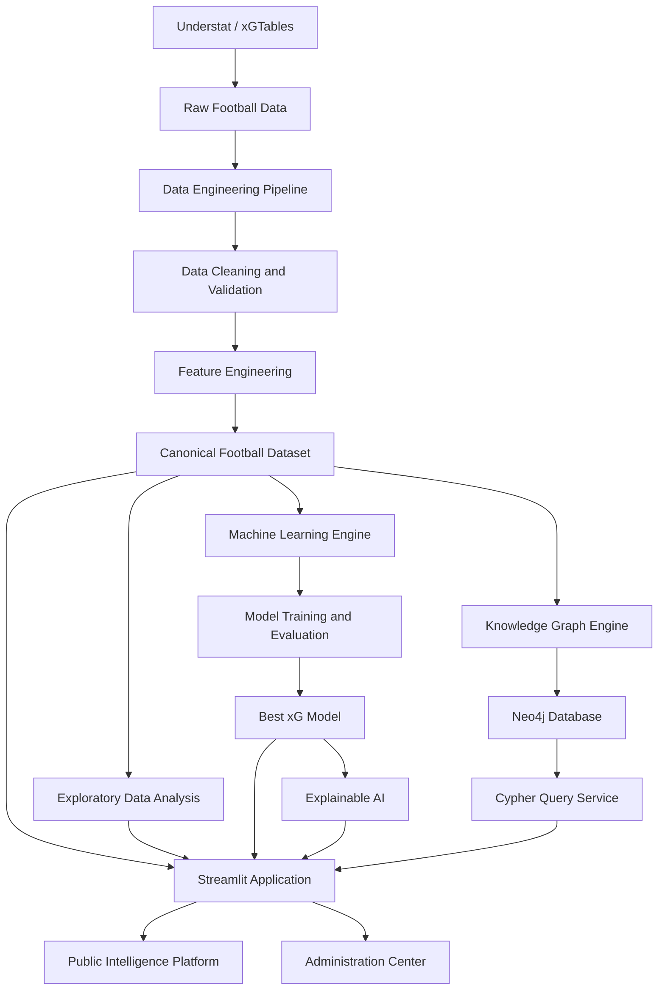
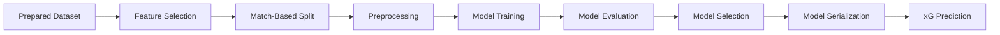
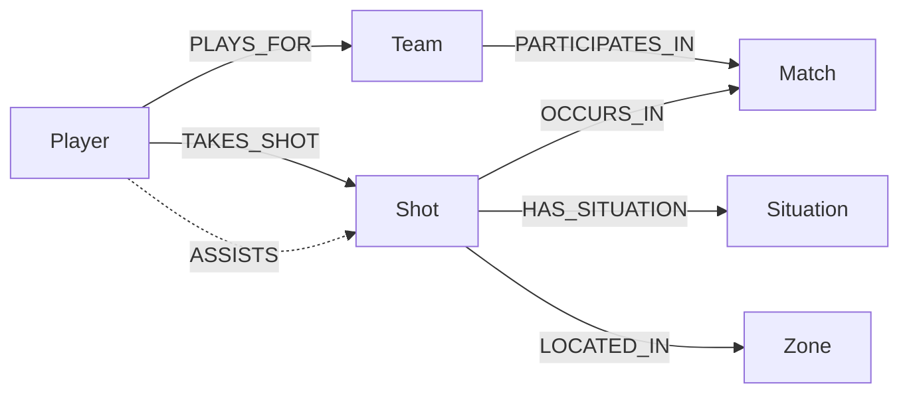
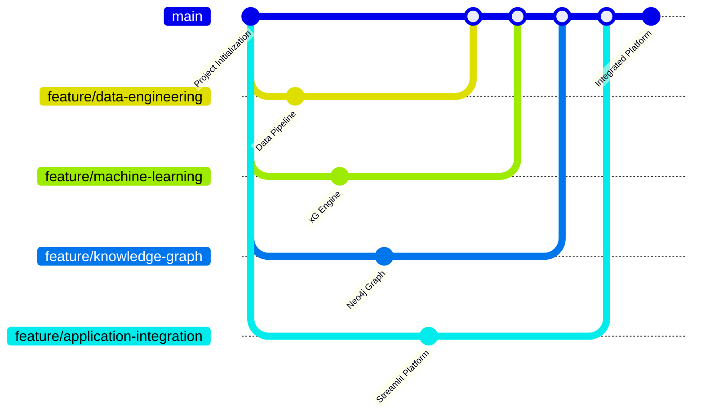

# ⚽ FootMind AI

### Advanced Football Intelligence & Cognitive Analytics Platform


---

## 01. Project Overview

**FootMind AI** is an advanced football intelligence platform designed to transform historical football events into actionable, explainable and interconnected insights.

The project combines Data Engineering, Machine Learning, Explainable Artificial Intelligence, Knowledge Graph Engineering and interactive data visualization within a unified decision-support platform.

By leveraging historical football shot data, FootMind AI aims to provide a deeper understanding of shooting performance, expected goals (xG), player contributions and relationships between football entities.

The platform is designed for football analysts, sports enthusiasts, researchers and data-driven decision-makers.

---

## 02. Problem Statement

Traditional football statistics often focus on basic indicators such as goals, assists and total shots.

However, these indicators do not fully explain:

- The quality of scoring opportunities.
- The spatial distribution of dangerous shots.
- The contextual factors influencing shot quality.
- The relationships between players, teams and football events.
- The differences between individual and collective performances.

FootMind AI addresses these limitations through an integrated analytical and cognitive approach.

---

## 03. Project Objectives

- Build a reliable and reproducible football data pipeline.
- Analyze individual and collective football performances.
- Identify dangerous shooting zones through spatial analytics.
- Develop Machine Learning models for expected goals estimation.
- Compare and interpret multiple regression algorithms.
- Construct a football Knowledge Graph using Neo4j.
- Explore football relationships through Cypher queries.
- Provide an interactive and explainable decision-support platform.
- Ensure reproducibility, modularity and data quality.

---

## 04. System Architecture



The architecture follows a modular approach in which all components rely on a shared, validated football dataset.

---

## 05. Dataset

| Attribute | Description |
|---|---|
| Data source | Understat via xGTables |
| Competition | English Premier League |
| Season | 2024/2025 |
| Target sample size | 1,500 shots |
| Data format | CSV |
| Target variable | Understat Expected Goals (xG) |
| Sampling strategy | Reproducible random sampling |
| Random seed | 42 |

### Source Files

- `shots.csv`: Football shot events and contextual information.
- `fixtures.csv`: Match information and participating teams.
- `players.csv`: Player-related information.

### Canonical Dataset

The data engineering pipeline will generate:

```text
data/processed/football_shots.csv
```

This dataset will serve as the single source of truth for the Machine Learning engine, Knowledge Graph and Streamlit application.

The exact source schema and available attributes will be validated before implementation.

---

## 06. Core Intelligence Modules

### Module 1 — Data Engineering & Football Intelligence

Responsible for building a reliable and reproducible data foundation.

#### Main Features

- Data collection and source documentation.
- Data profiling and quality assessment.
- Missing value and duplicate management.
- Data integration and controlled joins.
- Reproducible sampling.
- Spatial feature engineering.
- Exploratory Data Analysis.
- Data dictionary generation.

#### Engineered Features

- Distance to goal.
- Shooting angle.
- Shooting zone.
- Match period.
- Shot context.
- Player and team associations.

#### Analytical Dimensions

| Dimension | Analysis |
|---|---|
| Spatial | Shot maps and dangerous zones |
| Temporal | Shot distribution across match periods |
| Individual | Player shooting performance |
| Collective | Team-level performance |
| Situational | Shot type and game context |

---

### Module 2 — Machine Learning & Explainable xG

The Machine Learning engine aims to estimate the expected goals value of a football shot by learning from historical Understat xG values.

#### Models

| Model | Category |
|---|---|
| Linear Regression | Statistical baseline |
| Random Forest Regressor | Ensemble Learning |
| Gradient Boosting Regressor | Boosting |

#### Machine Learning Pipeline



#### Evaluation Protocol

- 80% of matches for training.
- 20% of matches for testing.
- Group-based separation using `fixture_id`.
- Prevention of target leakage.
- Identical evaluation conditions for all models.
- Reproducible preprocessing and training.

#### Evaluation Metrics

- Mean Absolute Error (MAE).
- Root Mean Squared Error (RMSE).
- Coefficient of Determination (R²).
- Residual analysis.
- Feature importance.

#### Model Performance

| Model | MAE | RMSE | R² |
|---|---|---|---|
| Linear Regression | Pending | Pending | Pending |
| Random Forest | Pending | Pending | Pending |
| Gradient Boosting | Pending | Pending | Pending |

Actual performance metrics will be published after model training and evaluation.

#### Explainable Artificial Intelligence

The explainability layer is intended to identify the main factors influencing estimated xG values.

Planned methods include:

- Feature importance.
- Permutation importance.
- SHAP explanations (advanced extension).
- Prediction interpretation.

#### Inference Interface

```python
predict_xg(shot_features) -> float
```

The selected preprocessing pipeline and trained model will be serialized in:

```text
models/best_xg_model.pkl
```

---

### Module 3 — Cognitive Knowledge Graph Engineering

The Knowledge Graph represents football entities and their contextual relationships using Neo4j.

It enables relational exploration beyond traditional tabular analysis.

#### Graph Data Model



#### Graph Entities

| Node | Description |
|---|---|
| Player | Football player |
| Team | Football team |
| Match | Football fixture |
| Shot | Individual shooting event |
| Situation | Context of the shot |
| Zone | Spatial shooting area |

The `ASSISTS` relationship will only be created when supported by the source data.

#### Cognitive Queries

The Knowledge Graph will answer five main analytical questions:

1. Which players have taken the highest number of shots?
2. Which players have accumulated the highest xG?
3. Which players contribute the most to passes leading to shots?
4. Which teams generate the highest average xG?
5. Which shooting zones contain the most dangerous opportunities?

#### Technologies

- Neo4j Community Edition.
- Cypher Query Language.
- Neo4j Python Driver.
- NetworkX.
- PyVis.

---

### Module 4 — AI Application & System Integration

The application integrates the analytical, predictive and cognitive components into a unified Streamlit platform.

#### Public Intelligence Platform

| Interface | Functionality |
|---|---|
| Executive Dashboard | Global football KPIs and performance indicators |
| Shot Intelligence | Interactive shot maps and spatial analysis |
| xG Prediction Lab | Expected goals estimation for new shots |
| Knowledge Explorer | Graph visualization and cognitive queries |

#### Administration Center

The administration interface is a proposed extension for internal system supervision.

Planned features:

- Protected administrator access.
- Data quality monitoring.
- Dataset management.
- Machine Learning performance monitoring.
- Knowledge Graph monitoring.
- System health indicators.

Administrator credentials must never be exposed in the public repository.

---

## 07. Advanced Features & Innovation

The following extensions are planned after validation of the core platform.

| Feature | Description | Status |
|---|---|---|
| What-if Shot Simulator | Simulate different shooting scenarios | Planned |
| Player Comparison Studio | Compare individual shooting profiles | Planned |
| Explainable xG | Interpret the factors influencing xG | Planned |
| SHAP Intelligence | Explain individual model predictions | Proposed |
| Graph Insight Cards | Natural-language questions mapped to controlled Cypher queries | Planned |
| Admin Intelligence | Monitor data, models and graph services | Proposed |
| GraphRAG Assistant | Conversational exploration of graph knowledge | Future extension |

These extensions are not considered completed features.

---

## 08. Technology Stack

| Layer | Technologies |
|---|---|
| Programming | Python |
| Data Engineering | Pandas, NumPy, SciPy, PyArrow |
| Machine Learning | Scikit-learn, Joblib |
| Explainable AI | Feature Importance, SHAP |
| Knowledge Graph | Neo4j, Cypher |
| Graph Visualization | NetworkX, PyVis |
| Data Visualization | Plotly, Matplotlib, Seaborn |
| Football Visualization | mplsoccer |
| Application | Streamlit |
| Infrastructure | Docker, Docker Compose |
| Version Control | Git, GitHub |
| Testing | Pytest, Pytest-cov |
| Code Quality | Ruff |
| Experimentation | Jupyter Notebook |

---

## 09. Repository Structure

```text
FOOTMIND-AI/
│
├── .github/
│   └── workflows/
│
├── .streamlit/
│   └── config.toml
│
├── data/
│   ├── raw/
│   ├── processed/
│   └── metadata/
│
├── notebooks/
│   ├── 01_data_preparation.ipynb
│   ├── 02_eda_features.ipynb
│   └── 03_model_training.ipynb
│
├── src/
│   ├── common/
│   │   └── config.py
│   │
│   ├── data/
│   │   ├── prepare_data.py
│   │   ├── features.py
│   │   ├── validate_data.py
│   │   └── eda.py
│   │
│   ├── ml/
│   │   ├── train_models.py
│   │   ├── evaluate.py
│   │   ├── predict.py
│   │   └── explainability.py
│   │
│   └── graph/
│       ├── connection.py
│       ├── build_graph.py
│       ├── queries.cypher
│       └── graph_service.py
│
├── models/
│   ├── best_xg_model.pkl
│   └── metrics.json
│
├── app/
│   ├── app.py
│   ├── pages/
│   │   ├── 01_Executive_Dashboard.py
│   │   ├── 02_Shot_Intelligence.py
│   │   ├── 03_xG_Lab.py
│   │   └── 04_Knowledge_Explorer.py
│   │
│   ├── admin/
│   │   ├── dashboard.py
│   │   ├── data_management.py
│   │   ├── model_management.py
│   │   └── graph_management.py
│   │
│   ├── components/
│   │   ├── authentication.py
│   │   ├── charts.py
│   │   ├── football_pitch.py
│   │   └── sidebar.py
│   │
│   └── assets/
│       ├── css/
│       └── images/
│
├── reports/
│   ├── data_quality/
│   ├── figures/
│   ├── ml_evaluation/
│   ├── graph/
│   └── screenshots/
│
├── tests/
│   ├── test_data.py
│   ├── test_ml.py
│   ├── test_graph.py
│   └── test_app.py
│
├── docs/
│   ├── architecture.md
│   ├── data_contract.md
│   ├── graph_schema.md
│   └── installation.md
│
├── .env.example
├── .gitignore
├── docker-compose.yml
├── requirements.txt
└── README.md
```

The repository structure includes both initialized files and planned deliverables.

---

## 10. Installation & Local Setup

### Prerequisites

- Python 3.11 or 3.12.
- Git.
- Docker Desktop.
- A compatible code editor.
- Access to the required football datasets.

### Step 1 — Clone the Repository

```bash
git clone https://github.com/ijlal-sellak/FOOTMIND-AI.git
cd FOOTMIND-AI
```

### Step 2 — Create a Virtual Environment

```bash
python -m venv .venv
```

Windows CMD:

```cmd
.venv\Scripts\activate.bat
```

Windows PowerShell:

```powershell
.\.venv\Scripts\Activate.ps1
```

Linux / macOS:

```bash
source .venv/bin/activate
```

### Step 3 — Install Dependencies

```bash
python -m pip install --upgrade pip
python -m pip install -r requirements.txt
```

### Step 4 — Configure Environment Variables

Windows CMD:

```cmd
copy .env.example .env
```

Linux / macOS:

```bash
cp .env.example .env
```

Configure the following environment variables:

```env
PROJECT_NAME="FootMind AI"
APP_ENV=development

DATA_SEASON=2024/2025
DATA_LEAGUE=EPL
SAMPLE_SIZE=1500
RANDOM_STATE=42

NEO4J_URI=bolt://localhost:7687
NEO4J_USER=neo4j
NEO4J_PASSWORD=YOUR_PASSWORD

ADMIN_PASSWORD=YOUR_ADMIN_PASSWORD
```

Never commit the `.env` file to GitHub.

### Step 5 — Start Neo4j

```bash
docker compose up -d
```

Neo4j Browser:

http://localhost:7474

### Step 6 — Launch the Application

```bash
python -m streamlit run app/app.py
```

Application URL:

http://localhost:8501

**Development note:** These setup instructions describe the intended workflow. The configuration files and application modules must be implemented before the complete platform can run.

---

## 11. Team Organization

The project follows a modular collaborative development approach.

| Member | Role | Responsibility |
|---|---|---|
| Member 1 | Data Engineer & Football Intelligence Analyst | Data preparation, feature engineering and EDA |
| Member 2 | Machine Learning & Explainable AI Engineer | xG estimation, model evaluation and interpretation |
| Member 3 | Knowledge Graph Engineer | Neo4j, graph modeling and Cypher queries |
| Member 4 | AI Application & Integration Engineer | Streamlit, integration, testing and deployment |

---

## 12. GitHub Collaboration Strategy



### Development Branches

| Branch | Purpose |
|---|---|
| `main` | Stable integrated version |
| `feature/data-engineering` | Data pipeline and football analytics |
| `feature/machine-learning` | Predictive intelligence |
| `feature/knowledge-graph` | Cognitive graph engine |
| `feature/application-integration` | Public and administrator interfaces |

### Contribution Workflow

1. Select the appropriate development branch.
2. Implement and test the assigned module.
3. Commit changes using descriptive messages.
4. Push changes to the remote repository.
5. Open a Pull Request.
6. Perform cross-review before integration.

Direct changes to the stable branch should be avoided during collaborative development.

---

## 13. Testing & Quality Assurance

The project will include automated tests for each technical module.

### Data Quality

- Unique shot identifiers.
- Valid xG values.
- Valid spatial coordinates.
- Expected dataset size.
- Referential integrity.
- Missing value management.

### Machine Learning

- Target leakage prevention.
- Match-based train/test separation.
- Model serialization and loading.
- Valid prediction outputs.
- Consistent feature transformations.

### Knowledge Graph

- Node and relationship integrity.
- Cypher query validation.
- Consistency with tabular analytics.
- Neo4j connection management.

### Application

- Input validation.
- Empty-state management.
- Error handling.
- Model integration.
- Graph service availability.
- Administrator access control.

### Planned Test Commands

```bash
python -m pytest tests/ -v
```

```bash
python -m pytest --cov=src --cov=app
```

```bash
ruff check .
```

---

## 14. Project Roadmap

| Phase | Main Activities | Status |
|---|---|---|
| Phase 0 | Repository and project structure | In progress |
| Week 1 | Data collection, quality and architecture | Planned |
| Week 2 | EDA, Machine Learning and graph construction | Planned |
| Week 3 | Model evaluation and application integration | Planned |
| Week 4 | Testing, documentation and final demonstration | Planned |
| Future | Advanced AI and cognitive extensions | Proposed |

### Integration Milestones

- [ ] Gate A — Validated canonical dataset and data dictionary.
- [ ] Gate B — Validated ML pipeline and inference contract.
- [ ] Gate C — Operational Knowledge Graph and Cypher services.
- [ ] Gate D — Fully integrated and reproducible application.

---

## 15. Expected Deliverables

- [ ] Reproducible data engineering pipeline.
- [ ] Validated football dataset containing 1,500 shots.
- [ ] Data dictionary and quality report.
- [ ] At least five exploratory visualizations.
- [ ] Three trained and evaluated regression models.
- [ ] Serialized preprocessing and prediction pipeline.
- [ ] Explainable Machine Learning analysis.
- [ ] Neo4j football Knowledge Graph.
- [ ] Five validated cognitive queries.
- [ ] Interactive Streamlit application.
- [ ] Automated tests and technical documentation.
- [ ] Final academic report and project demonstration.

---

## 16. Scientific Limitations

- The estimated xG approximates the historical Understat reference model rather than a directly calibrated probability of scoring.
- The selected sample does not necessarily represent the entire football season.
- Available event data does not provide complete player movement, defensive pressure or passing network information.
- Observed correlations do not establish tactical causality.
- Model performance must be evaluated using actual experimental results.
- Knowledge Graph relationships must be supported by available data.

---

## 17. Future Perspectives

Potential future developments include:

- Multi-season football intelligence.
- Advanced player profiling.
- Interactive tactical simulations.
- Cross-team and cross-season model evaluation.
- Real-goal probability modeling.
- Advanced Explainable AI.
- GraphRAG-powered football assistant.
- Cloud deployment and automated CI/CD.

---

## 18. Academic Context

**Institution:** École des Sciences de l'Information (ESI), Rabat, Morocco.

**Engineering Program:** Data Science & Knowledge Engineering.

**Module:** Cognitive Computing and Knowledge Graphs.

**Academic Year:** 2026–2027.

**Project Type:** Academic Artificial Intelligence and Data Science Project.

---

## 19. References

- Understat: https://understat.com/
- Neo4j Documentation: https://neo4j.com/docs/
- Scikit-learn: https://scikit-learn.org/
- Streamlit: https://docs.streamlit.io/
- SHAP: https://shap.readthedocs.io/
- mplsoccer: https://mplsoccer.readthedocs.io/

Data provenance and redistribution conditions will be documented during the data collection phase.

---

## 20. Project Status

 **Under Active Development**

FootMind AI is currently in its initialization and development phase.

Features, experimental results and technical deliverables will be progressively integrated and validated.

---

<div align="center">

### FOOTMIND AI

**Transforming Football Data into Predictive Intelligence and Connected Knowledge.**

Data Engineering • Machine Learning • Explainable AI • Knowledge Graphs

Developed as part of the Data Science & Knowledge Engineering program at ESI.

</div>

